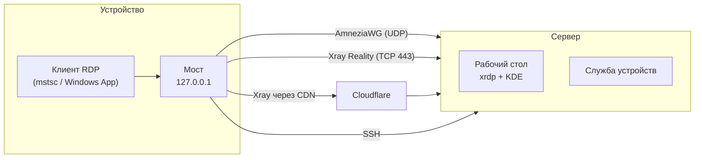

<div align="center">

# Мост

**Удалённый рабочий стол, который не теряет связь.**

Одна кнопка «Подключиться» — и рабочий стол удалённого сервера на **Ubuntu** открыт, даже когда прямой путь
до сервера режется или работает через раз. «Мост» сам держит несколько каналов, выбирает живой и переключается при обрыве.


</div>

---

## Зачем

Обычный RDP — это одно TCP-соединение до одного адреса. Если по дороге его режут, рвут посреди сеанса
или пропускают через раз, работать нельзя. «Мост» решает это на стороне клиента:

- держит **сразу несколько каналов разной природы** до одного сервера;
- **проверяет каждый** до самого рабочего стола и ведёт подключение по живому;
- **при обрыве переключается** на следующий, а окно рабочего стола переподключается само;
- **ставит сервер с нуля** — от чистой Ubuntu до готового рабочего стола одной кнопкой.

## Возможности

### Каналы

| Канал | Как устроен | Когда выручает |
|---|---|---|
| **AmneziaWG** | UDP-туннель с маскировкой, встроен в программу — без драйвера и прав администратора | Основной: быстрый и устойчивый |
| **Xray Reality** | VLESS + Reality на TCP 443, маскировка под **свой сайт** на этом же сервере | Когда UDP закрыт |
| **Xray через CDN** | VLESS + WebSocket + TLS за Cloudflare | Когда прямой путь до адреса сервера режется |
| **SSH** | Проброс только до рабочего стола, свой ключ у каждого устройства | Запасной |

- **Автовыбор по надёжности**, а не по скорости: долгому сеансу важнее, чтобы канал не рвался.
- **Каждый канал проверяется отдельно**: живой — раз в 30 секунд, упавший — через 3, 5, 10, 20 секунд.
- **Сон компьютера**: после пробуждения прежние «работает» сбрасываются и каналы перепроверяются сразу.
- **Холодный старт AWG за доли секунды**: если провайдер глушит UDP-поток, туннель пересоздаётся на новом порту.

### Сервер

- **Мастер «Новый сервер»**: чистая Ubuntu 24.04 или 26.04 → защита (ufw, fail2ban, автообновления),
  AmneziaWG, свой DNS, Xray, служба устройств, по желанию — рабочий стол KDE с RDP, Chrome и Claude Desktop.
- **Маскировка под свой домен**: страница-заглушка с настоящим сертификатом, TLS 1.2 и 1.3, HSTS,
  без заголовка `Server`, порт 80 отвечает переадресацией на https.
- **Повторный запуск безопасен**: мастер доставляет недостающее и не перезапускает службы без нужды —
  открытые сеансы не рвутся, пароль рабочего стола сохраняется.
- **Параметры маскировки обновляются сами**: сменили домен на сервере — программы получат его без переустановки.

### Устройства

- **У каждого устройства свои ключи** AWG и SSH, созданные на самом устройстве: закрытые никуда не уходят.
- **Приглашения**: файл на сутки, одноразовый; ожидающие приглашения видны в списке и отменяются.
- **Потерянное устройство** удаляется — его ключи перестают работать, остальные не задеты.

### Удобство

- Значок у часов (Windows, macOS), автозапуск, папка обмена с сервером, графики скорости и задержки, журнал.
- **«Через наш канал»**: локальный прокси SOCKS5/HTTP — браузер и выбранные программы выходят в интернет через сервер.
- **Подписанное автообновление** на Windows: новые версии приходят из [Releases](../../releases) этого репозитория (если GitHub недоступен — с сервера через каналы), программа проверяет подпись Ed25519 и докачивает обновление при обрывах.
- Один и тот же интерфейс на всех платформах, светлая и тёмная тема.

## Как это работает



Клиент RDP подключается к «Мосту» на своём же компьютере, а «Мост» передаёт соединение по лучшему каналу.
Служба устройств на сервере доступна только изнутри каналов.

## Платформы

| | Окно | Рабочий стол открывается в | Особенности |
|---|---|---|---|
| **Windows 10 / 11** | своё окно на WebView2 (входит в Windows) | Подключение к удалённому рабочему столу (mstsc) | значок у часов, автообновление, папка обмена, «Через наш канал» |
| **macOS 12+** | приложение на Swift + WebKit, одна сборка для Intel и Apple Silicon | Microsoft Windows App | значок в строке меню, автозапуск, папка обмена |
| **Android 8+** | приложение на Java + WebView, адаптировано под планшеты | Microsoft Windows App | фоновая служба держит каналы |

Ядро — общее для всех платформ, на Go, без CGO.

## Удалённый компьютер

Сервер, к рабочему столу которого подключается «Мост», — **Ubuntu Server 24.04 LTS или 26.04 LTS**, x86_64.
Мастер «Новый сервер» ставит всё сам; другие системы не поддерживаются.

| Что | Версия |
|---|---|
| Система | Ubuntu 24.04 LTS (noble) или 26.04 LTS, x86_64 |
| Рабочий стол | KDE Plasma (5 на 24.04, 6 на 26.04) + xrdp с автовходом, русский интерфейс |
| AmneziaWG | amneziawg-go v3.1.20260828, amneziawg-tools v3.1.20260812 (собираются из исходников) |
| Xray | Xray-core v26.10.31 (собирается из исходников) |
| DNS для туннеля | unbound из репозитория Ubuntu |
| Сайт для маскировки | nginx + сертификат Let's Encrypt (certbot) |
| По желанию | Google Chrome (репозиторий Google), Claude Desktop (официальная бета Anthropic для Linux) |
| Требования | от 2 ГБ памяти, с рабочим столом — от 4 ГБ; от 20 ГБ на диске |

## Начать

1. Арендуйте сервер с чистой **Ubuntu 24.04 или 26.04** (от 4 ГБ памяти для рабочего стола).
2. Откройте «Мост» → **«Новый сервер»**, укажите адрес и пароль от хостера.
   По желанию — свой домен для маскировки (A-запись на сервер, без облака) и домен для CDN.
3. Через 20–30 минут сервер готов: **«Переключиться на этот сервер»** → **«Подключиться»**.
4. Другие устройства — через **«Устройства» → «Создать приглашение»**.

## Сборка

<details>
<summary><b>Windows</b></summary>

```bash
bash tools/build_windows.sh 0.9.23        # dist/most-0.9.23.exe
```
Нужен Go 1.27+. Версия программы — `var version` в `core/app.go`.
</details>

<details>
<summary><b>macOS</b></summary>

```bash
bash mac/build_mac.sh 0.9.23              # dist/Мост.app (Intel + Apple Silicon)
```
Нужны Go 1.27+ и Command Line Tools for Xcode. Подпись — без сертификата разработчика.
</details>

<details>
<summary><b>Android</b></summary>

```bash
bash tools/android_sdk_setup.sh           # JDK, Android SDK, NDK, gomobile (один раз)
bash android/build_android.sh 0.9.23 113  # APK; ключ подписи создаётся при первой сборке
```
</details>

<details>
<summary><b>Служба устройств</b></summary>

`server/most-admin/` — её ставит мастер. `core/setup/most-admin.go.txt` — копия, которую мастер
передаёт на сервер: меняя службу, обновляйте обе.
</details>

## Устройство кода

| Папка | Что внутри |
|---|---|
| `core/` | Ядро: каналы, автовыбор, прокси, устройства, профили, мастер, обновления, окно (`core/web/`) |
| `core/setup/` | Скрипт подготовки сервера (вшит в программу) и исходник службы устройств |
| `cmd/most/`, `cmd/most-core/` | Точки входа: Windows и ядро для macOS |
| `mobile/` | Ядро для Android (gomobile) |
| `android/`, `mac/` | Оболочки Android и macOS |
| `server/most-admin/` | Служба управления устройствами на сервере |
| `tools/` | Сборка и выпуск обновлений |

## Безопасность

- Закрытые ключи AWG и SSH создаются на устройстве и не покидают его. Профили на устройстве
  зашифрованы (DPAPI на Windows, AES-256-GCM на остальных).
- SSH-ключ устройства на сервере ограничен: только проброс до рабочего стола, без командной строки.
- Окно программы доступно только с этого же компьютера и только с ключом доступа.
- Служба устройств слушает только внутри туннеля; управление — по токену владельца.
- Обновления подписаны Ed25519; программа сверяет подпись и SHA-256 до установки.
- Секреты (ключи подписи, профили, приглашения) в репозиторий не попадают — см. `.gitignore`.

## Лицензия

[MIT](LICENSE)
